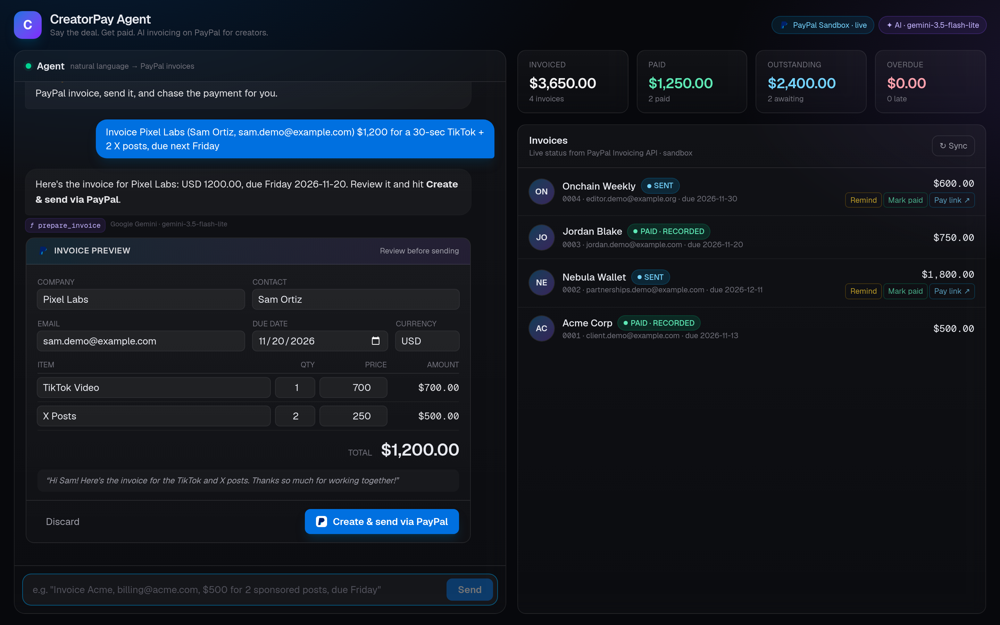
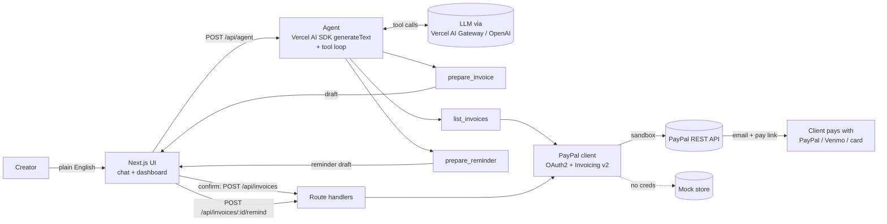
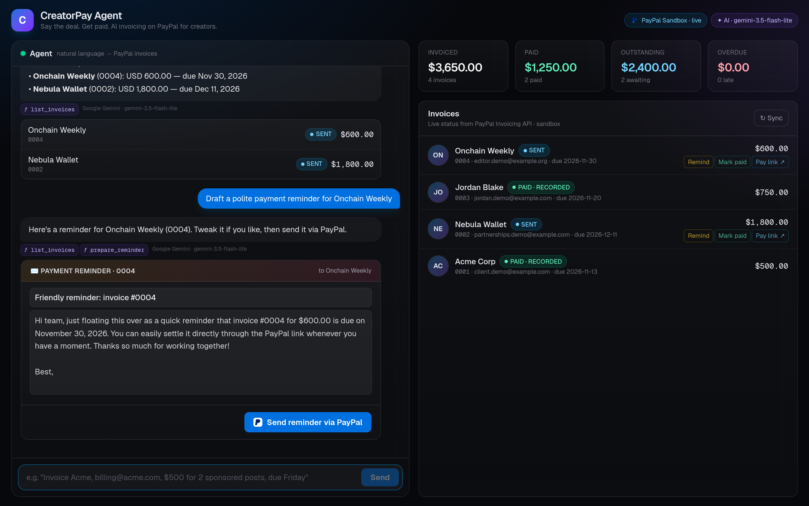
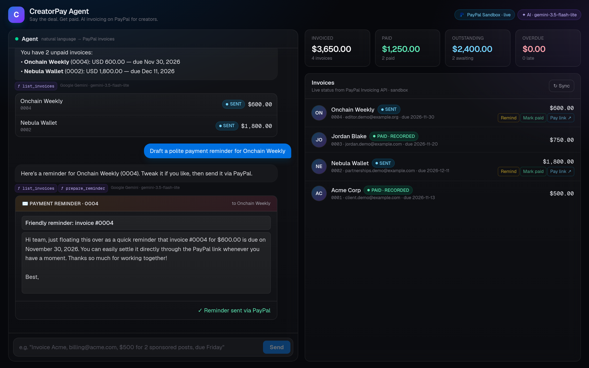
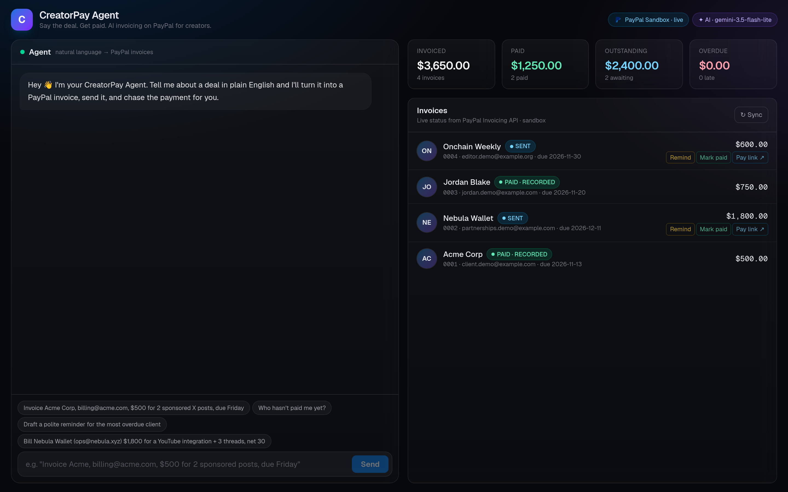

# CreatorPay Agent

**Say the deal. Get paid.** An AI invoicing agent for creators and freelancers, built on the **PayPal Invoicing API** and the **Vercel AI SDK**.

> Built for the [PayPal AI Hackathon](https://paypalaihackathon.devpost.com/) by [@0xZiggy_eth](https://x.com/0xZiggy_eth).



## The problem

Creators get paid by brands, DAOs, agencies and fans, but the admin side is painful. Deals get agreed in DMs ("$500 for 2 posts, pay by Friday?"). Someone then has to turn that into a proper invoice, send it, remember who has paid, and chase late payers without sounding awkward. Most creators skip the invoice and just hope, which is how they end up unpaid.

## The solution

CreatorPay Agent lets you invoice the way you already talk:

> *"Invoice Acme Corp, billing@acme.com, $500 for 2 sponsored X posts, due Friday"*

The agent turns that sentence into a structured invoice: recipient, line items (2 × $250), currency, due date resolved to a real date, and a friendly note. It shows you an editable preview. When you confirm, it **creates and sends a real PayPal invoice**. PayPal emails your client a pay link, and they can pay with PayPal, Venmo or a card.

Then you can just ask:

- *"Who hasn't paid me yet?"* The agent calls PayPal, checks live statuses, and lists outstanding and overdue invoices.
- *"Draft a polite reminder for the most overdue client"* The agent writes a warm, personalised reminder. You review it, and it goes out through **PayPal's reminder endpoint**.

## Features

- 💬 **Natural-language invoicing.** The LLM uses tool calling to turn free text into a validated invoice schema. Relative dates such as "Friday", "net 30" and "end of month" are resolved against today's date.
- 🧾 **Editable preview card (human in the loop).** Nothing reaches a client until you click *Create & send via PayPal*.
- 📤 **Real PayPal invoices.** The app generates the invoice number, creates the draft and sends it. Your client gets PayPal's hosted pay page.
- 📊 **Live dashboard.** Invoiced, paid, outstanding and overdue totals, plus every invoice with its live PayPal status (DRAFT / SENT / PAID / CANCELLED …) and overdue days.
- 🤖 **Agentic queries.** For "Who owes me?" and "What's overdue?", the agent decides which tools to call and answers from live data.
- ✉️ **AI payment reminders.** The agent drafts the reminder and PayPal delivers it (`/remind`). There's one-click *Remind* on any open invoice.
- ✅ **Mark paid.** Records an external payment (bank transfer, crypto and so on) through PayPal's record-payment endpoint, and the invoice becomes `MARKED_AS_PAID`. Invoices the client pays on PayPal's pay page show up as `PAID`.
- 🧪 **Mock mode.** With no PayPal keys, the app runs against an in-memory store with the same interface. This makes it easy to develop and demo offline.
- 🛟 **Rule-based fallback.** With no AI key, a deterministic parser stands in for the LLM so the UI never breaks. The badge in the header always shows which engine is active.

## Architecture



**Human-in-the-loop by design:** the AI tools only *prepare* drafts. Anything that touches money or emails a client (create/send invoice, send reminder) needs an explicit click in the UI.

### Project layout

```
src/
  app/
    page.tsx                         # chat + dashboard UI
    api/agent/route.ts               # runs the AI agent
    api/invoices/route.ts            # GET list · POST create+send
    api/invoices/[id]/remind/route.ts
    api/invoices/[id]/pay/route.ts   # record payment (sandbox demo)
    api/status/route.ts              # which PayPal mode / AI model is active
  lib/
    agent.ts      # system prompt + tools (prepare_invoice, list_invoices, prepare_reminder)
    ai.ts         # model selection (Gemini → AI Gateway → OpenAI → none)
    paypal.ts     # PayPal OAuth + Invoicing v2 client, plus mock store
    fallback.ts   # rule-based parser used only when no AI key is set
  components/     # InvoicePreview, ReminderCard, Dashboard
```

## PayPal APIs used

All calls go to `https://api-m.sandbox.paypal.com` (configurable through `PAYPAL_API_BASE`).

| Purpose | Endpoint |
|---|---|
| OAuth2 access token (cached) | `POST /v1/oauth2/token` |
| Next invoice number | `POST /v2/invoicing/generate-next-invoice-number` |
| Create draft invoice | `POST /v2/invoicing/invoices` |
| Send invoice to client | `POST /v2/invoicing/invoices/{id}/send` |
| List invoices + live status | `GET /v2/invoicing/invoices` |
| Invoice details | `GET /v2/invoicing/invoices/{id}` |
| Payment reminder | `POST /v2/invoicing/invoices/{id}/remind` |
| Record payment (demo "mark paid") | `POST /v2/invoicing/invoices/{id}/payments` |
| Cancel invoice | `POST /v2/invoicing/invoices/{id}/cancel` |

## AI tools used and how

- **Vercel AI SDK** (`ai` v7): `generateText` with **tool calling** and a multi-step tool loop (`stopWhen: isStepCount(6)`). Tool inputs are defined with **Zod** schemas, so model output is validated before use.
- **LLM**: **Google Gemini** (`@ai-sdk/google`, default `gemini-3.5-flash-lite` (fast, and strong at tool calling) with automatic fallback to `gemini-3.5-flash` / `gemini-flash-latest` when one is rate-limited) when `GEMINI_API_KEY` is set; otherwise the **Vercel AI Gateway** (default `openai/gpt-5.4-mini`, override with `AI_MODEL`) or OpenAI directly with `OPENAI_API_KEY`.
- **Efficient agent loop:** the loop stops as soon as a preview card is ready (`hasToolCall`), and each call has a timeout and a single retry. That keeps it fast and inside free-tier limits.
- **Agent tools:**
  - `prepare_invoice` extracts recipient, email, line items (it splits totals across quantities), currency, due date and a note into a structured draft. It never invents email addresses and asks instead.
  - `list_invoices` fetches live invoices from PayPal, filtered as all / unpaid / overdue / paid. This powers questions like "who hasn't paid me?"
  - `prepare_reminder` writes a personalised reminder for a specific invoice, which is then sent through PayPal `/remind` once the user confirms.
- **AI-assisted development:** this project was built with an AI coding agent (Grok Bot), which handled scaffolding, implementation and docs. All code was reviewed and tested by the author.

## Getting started

```bash
git clone https://github.com/<you>/creatorpay-agent
cd creatorpay-agent
npm install
cp .env.example .env.local   # fill in keys (or leave blank for mock mode)
npm run dev                  # http://localhost:3000
```

### Get PayPal sandbox keys (about 5 minutes)

1. Sign in at [developer.paypal.com](https://developer.paypal.com) and go to **Apps & Credentials** (Sandbox).
2. **Create App** (type: Merchant), then copy the **Client ID** and **Secret** into `.env.local`.
3. Under **Testing Tools → Sandbox Accounts** you'll find a *personal* test account. Use its email as the invoice recipient, then log in to it to pay the invoice and watch the status flip to **PAID**.

### Environment variables

| Variable | Required | Description |
|---|---|---|
| `PAYPAL_CLIENT_ID` | for real mode | PayPal REST app client ID (sandbox) |
| `PAYPAL_CLIENT_SECRET` | for real mode | PayPal REST app secret |
| `PAYPAL_API_BASE` | no | Defaults to `https://api-m.sandbox.paypal.com` |
| `PAYPAL_INVOICER_NAME` / `PAYPAL_INVOICER_BUSINESS` | no | Invoicer name/business shown on invoices |
| `GEMINI_API_KEY` | one AI key | Google Gemini key (preferred when set) |
| `GEMINI_MODEL` | no | Comma-separated Gemini model chain |
| `AI_GATEWAY_API_KEY` | one AI key | Vercel AI Gateway key |
| `OPENAI_API_KEY` | one AI key | OpenAI key (alternative) |
| `OPENAI_BASE_URL` | no | Any OpenAI-compatible endpoint |
| `AI_MODEL` | no | Model override |

If no PayPal keys are set, the app runs in **Mock mode**. If no AI key is set, it uses the **rule-based fallback**. Both are shown in the header badges.

### Deploy

Deploy to Vercel or Render as a standard Next.js app and set the env vars above. On Vercel, AI Gateway can authenticate through OIDC, so no AI key is needed there.

## Screenshots

All screenshots below are **live**: PayPal sandbox plus Gemini (`gemini-3.5-flash-lite`).

| AI drafts the invoice | "Who hasn't paid me?" + AI reminder | Reminder sent via PayPal |
|---|---|---|
|  |  |  |



## License

[MIT](LICENSE)
